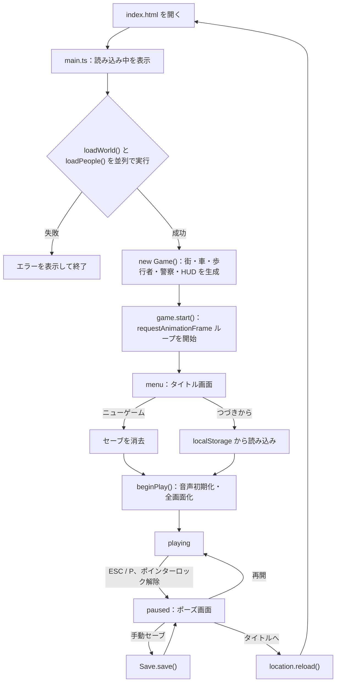
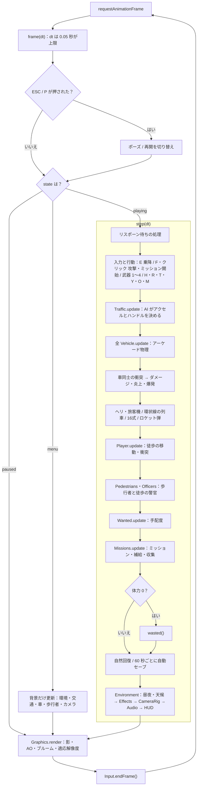
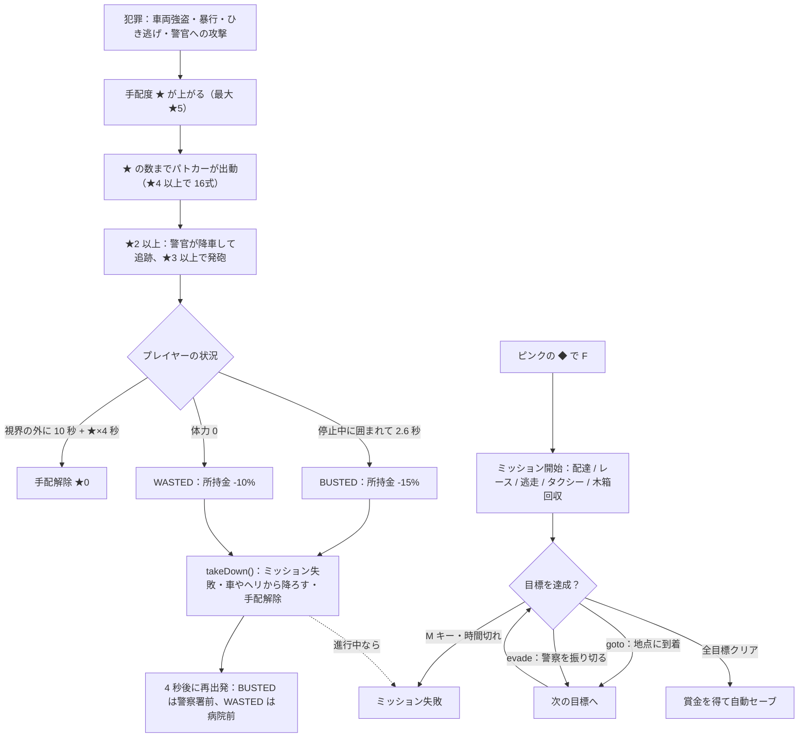
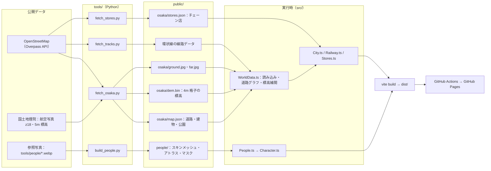

# 処理フロー

ゲームの処理の流れを 4 つのフローチャートにまとめたものです。モジュールの役割は [ARCHITECTURE.md](ARCHITECTURE.md) を参照してください。図は 2026-11-20 時点の main（00b175a）のコードから作成しています。

1. [起動と画面遷移](#1-起動と画面遷移)
2. [メインループ（1 フレーム）](#2-メインループ1-フレーム)
3. [死亡・逮捕・手配度・ミッション](#3-死亡逮捕手配度ミッション)
4. [地図データの生成（オフライン）](#4-地図データの生成オフライン)

## 1. 起動と画面遷移

地図と人物モデルを並列に読み込み、`Game` を作ってタイトル画面へ。状態は menu・playing・paused の 3 つだけで、タイトル画面の背景でも街の AI は動き続けます。

対応ファイル: `src/main.ts`, `src/Game.ts`, `src/world/WorldData.ts`, `src/entities/People.ts`, `src/systems/Save.ts`

## 2. メインループ（1 フレーム）

`Game.frame(dt)` の中身です。`dt` は 0.05 秒で頭打ちにします。playing のときだけ `step()` がゲームを進め、menu では環境・交通・歩行者・カメラだけを動かします。`debugStep()` は同じ `frame()` を回すテスト用の入口です。

対応ファイル: `src/Game.ts`, `src/ai/Traffic.ts`, `src/entities/Vehicle.ts`, `src/ai/Pedestrians.ts`, `src/ai/Officers.ts`, `src/core/Graphics.ts`

## 3. 死亡・逮捕・手配度・ミッション

犯罪で ★ が上がり、★ の数までパトカーが出動します（★4 以上で 16式）。止まったところをパトカーに囲まれて 2.6 秒たつと BUSTED です。警察の視界から「10 秒 + ★×4 秒」消え続けると手配が解除されます。WASTED と BUSTED はどちらもミッション失敗になり、所持金の一部を失って決まった場所から再出発します。

対応ファイル: `src/systems/Wanted.ts`, `src/systems/Missions.ts`, `src/ai/Officers.ts`, `src/Game.ts（takeDown / wasted / busted）`

## 4. 地図データの生成（オフライン）

ゲームは実行時に外部 API を呼びません。Python のツールが公開データを事前に変換して `public/` に焼き込み、ゲームはその静的ファイルを読むだけです。main への push で GitHub Pages に自動デプロイされます。

対応ファイル: `tools/fetch_osaka.py`, `tools/fetch_tracks.py`, `tools/fetch_stores.py`, `tools/build_people.py`, `.github/workflows/pages.yml`
